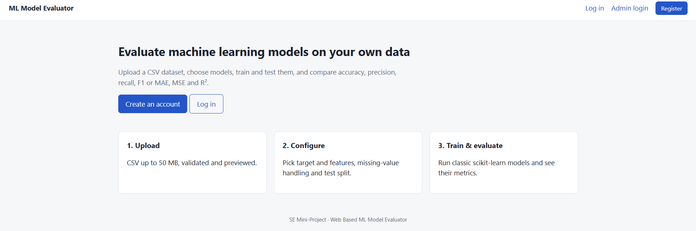
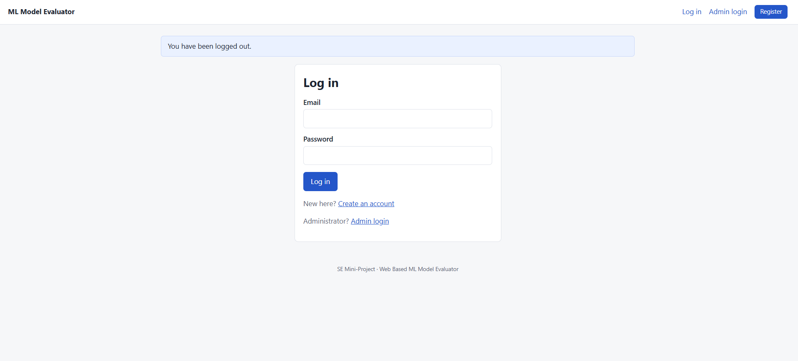
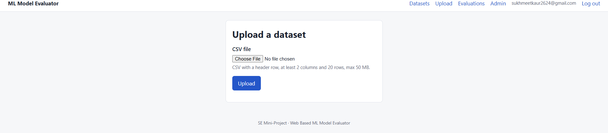
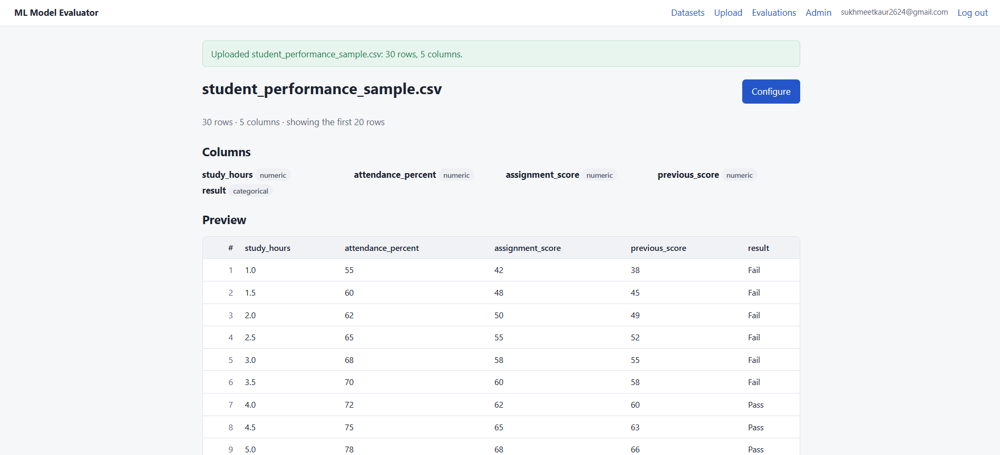
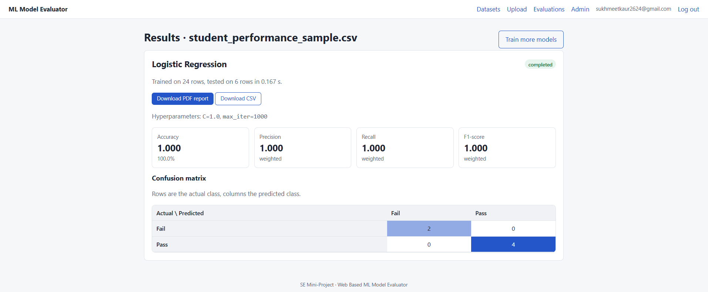
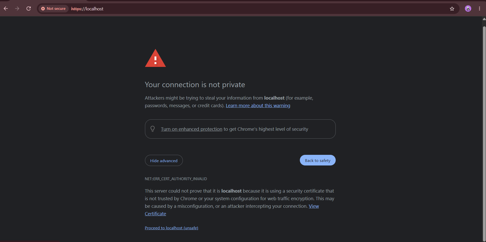

# SE Mini Project – Web-Based ML Model Evaluator

## 1. Project Introduction

The Web-Based ML Model Evaluator is a Django-based web application that allows users to upload CSV datasets, train machine learning models and evaluate their performance through various evaluation metrics.

The application provides a simple interface for comparing machine learning algorithms and downloading evaluation reports.

## 2. Features

- User registration and authentication.
- CSV dataset upload and validation.
- Dataset preview and feature selection.
- Target column selection.
- Missing-value handling.
- Train-test data splitting.
- Machine learning model training.
- Logistic Regression and Random Forest algorithms.
- Accuracy, Precision, Recall and F1-score evaluation.
- Confusion matrix visualization.
- Downloadable PDF reports.
- Downloadable CSV results.
- HTTPS-based secure deployment.

## 3. Technology Stack

| Component | Technology |
|---|---|
| Backend | Python, Django |
| Frontend | HTML, CSS, JavaScript |
| Machine Learning | Scikit-learn |
| Data Processing | Pandas, NumPy |
| Database | SQLite |
| Containerization | Docker, Docker Compose |
| Web Server / Reverse Proxy | Nginx |
| Security | HTTPS, SSL/TLS |

## 4. Project Structure

```text
SE-MiniProject/
│
├── .github/
├── accounts/
├── audit/
├── backlog/
├── backup/
├── datasets/
├── demo/
├── deploy/
│   └── nginx/
├── docs/
├── mlengine/
├── mlme/
├── reports/
├── sample_data/
├── scripts/
├── static/
├── templates/
├── tests/
├── Dockerfile
├── docker-compose.yml
├── requirements.txt
├── manage.py
├── test_summary.md
└── README.md
```

## 5. Installation and Execution

### Prerequisites

- Docker Desktop
- Git
- Web browser

### Clone the Repository

```bash
git clone https://github.com/SE-MiniProject-ML-Model-Evaluator/SE-MiniProject.git
cd SE-MiniProject
```

### Build and Start the Application

```bash
docker compose up --build -d
```

### Check Running Containers

```bash
docker compose ps
```

### View Application Logs

```bash
docker compose logs -f
```

## 6. HTTPS Deployment

The application uses Nginx as a reverse proxy.

Nginx handles incoming HTTP and HTTPS requests and forwards application requests to the Django web container.

### Access the Application

```text
https://localhost
```

### Verify HTTP Redirection

```bash
curl -I http://localhost
```

Expected response: HTTP 301 Moved Permanently.

### Verify HTTPS

```bash
curl -k -I https://localhost
```

Expected response: HTTP 200 OK.

Note: The `-k` option allows curl to test a locally configured certificate without verifying its trust chain.

## 7. Machine Learning Models

The application supports:

### Logistic Regression
A supervised classification algorithm used to predict categorical outcomes.

### Random Forest
An ensemble learning algorithm that combines multiple decision trees to improve prediction performance.

### Evaluation Metrics

- Accuracy
- Precision
- Recall
- F1-score
- Confusion Matrix

## 8. Screenshots

1. Application homepage.

2. User registration and login.

3. CSV dataset upload.

4. Model configuration.

5. Model evaluation results.

6. HTTPS application.


## 9. Demo Video

Sprint 2 demonstration video:

```text
demo/sprint2_demo.mp4
```

## 10. Testing and Documentation

Refer to the following files:

- `test_summary.md` – Test cases and results.
- `docs/sprint2_plan.md` – Sprint 2 plan and deviations.

## 11. Stopping the Application

```bash
docker compose down
```

## 12. Conclusion

The Web-Based ML Model Evaluator provides an accessible platform for uploading datasets, training machine learning models and comparing their performance. Docker and Nginx are used to support containerized deployment and HTTPS access.
